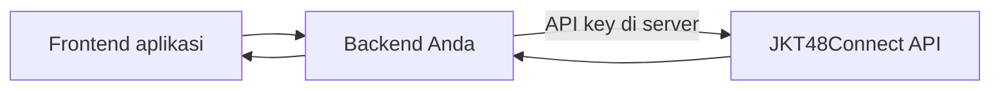
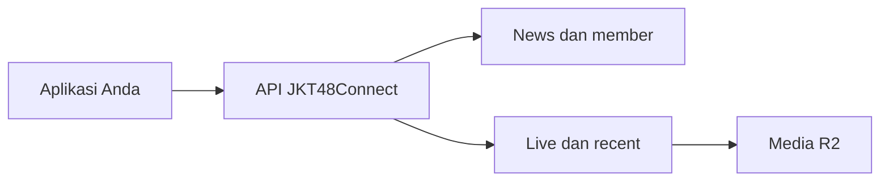

# JKT48Connect — panduan API publik

Base URL: `https://api.jkt48connect.app`.

## Tentang API


JKT48Connect menyediakan data JKT48 untuk website, aplikasi, bot komunitas, dan proyek penggemar. Mulai dari berita serta profil member, sampai jadwal theater dan rekap live.

## Satu alamat untuk integrasi

```text
https://api.jkt48connect.app
```

Gunakan **API Reference** untuk melihat method, path, parameter, label akses, dan contoh respons setiap endpoint. Pencarian tersedia melalui `Ctrl+K` atau `⌘K`.

| Kelompok | Data yang tersedia |
| --- | --- |
| Kabar & profil | News, member, ulang tahun, banner |
| Theater & acara | Jadwal, detail show, setlist, event |
| Live & recent | Sesi aktif, rekap, gift, leaderboard |
| Media | Foto, screenshot, gambar leaderboard, replay |

> [!NOTE]
> API ini merupakan proyek penggemar dan tidak berafiliasi dengan manajemen JKT48. Ketersediaan data mengikuti sumber dan sesi yang tercatat.

## Mulai dari data yang sederhana

News dan member dapat diakses tanpa API key. Endpoint lain menampilkan kebutuhan aksesnya di referensi. Gunakan contoh yang sesuai dengan endpoint tujuan.

[Ikuti quick start →](/docs/guide/mulai-menggunakan)


## Mulai menggunakan


Request pertama tidak membutuhkan instalasi SDK atau login. Contoh berikut mengambil berita terbaru.

## Coba dengan cURL

```sh
curl 'https://api.jkt48connect.app/api/news?page=1&perpage=10'
```

## Gunakan di JavaScript

```js
const base = 'https://api.jkt48connect.app';
const response = await fetch(`${base}/api/news?page=1&perpage=10`);
if (!response.ok) throw new Error(`HTTP ${response.status}`);
const data = await response.json();
console.log(data.news);
```

Bentuk respons ringkas:

```json
{
  "news": [],
  "page": 1,
  "perpage": 10,
  "total_count": 0
}
```

Contoh di atas memperlihatkan struktur, bukan hasil request live. Buka [referensi news](/docs/reference?route=GET%20%2Fapi%2Fnews) dan tekan **Coba GET** untuk melihat data saat ini.

## Lanjut ke member dan theater

```sh
curl 'https://api.jkt48connect.app/api/member'
curl 'https://api.jkt48connect.app/api/theater?page=1&perpage=10'
```

Ambil ID dari hasil daftar untuk membuka detail. Gunakan ID yang diberikan API; slug dan ID antarplatform tidak selalu sama.

## Python

```python
import requests

response = requests.get(
    'https://api.jkt48connect.app/api/news',
    params={'page': 1, 'perpage': 10},
    timeout=30,
)
response.raise_for_status()
print(response.json())
```


## Akses & integrasi


Label akses di API Reference menjelaskan kebutuhan setiap endpoint. Endpoint **Publik** dapat dipanggil tanpa credential. Beberapa data, termasuk daftar serta detail recent, memerlukan akses integrasi.

## API key untuk aplikasi

Minta akses API key kepada pengelola JKT48Connect. Gunakan key dari **backend** aplikasi dan simpan sebagai environment variable, bukan di JavaScript browser atau repository publik.

```sh
curl 'https://api.jkt48connect.app/api/recent?page=1&perpage=10' \
  -H "x-api-key: ${JKT48_API_KEY}"
```

```js
// Contoh pada backend Node.js.
const response = await fetch(
  'https://api.jkt48connect.app/api/recent?page=1&perpage=10',
  { headers: { 'x-api-key': process.env.JKT48_API_KEY } },
);
if (!response.ok) throw new Error(`HTTP ${response.status}`);
const data = await response.json();
```

> [!IMPORTANT]
> `SERVER_API_KEY` pada contoh referensi adalah placeholder. Halaman docs tidak menyimpan atau meminta key Anda. Playground hanya mencoba GET publik yang diizinkan.

## Frontend dan backend

Frontend dapat mengambil endpoint publik secara langsung. Untuk endpoint berkey, frontend memanggil backend Anda; backend menambahkan key sebelum meneruskan request.



## Ketika akses ditolak

Periksa status HTTP, label akses, dan bentuk header. Hindari mengirim key melalui parameter URL kecuali kontrak endpoint secara eksplisit memerlukannya. Jika key belum tersedia, mulai dari news, member, jadwal, atau media publik.


## News & member


Gunakan berita untuk kabar terbaru, dan data member untuk profil, tanggal lahir, serta gambar yang sudah disediakan API.

## Berita

```sh
curl 'https://api.jkt48connect.app/api/news?page=1&perpage=10'
curl 'https://api.jkt48connect.app/api/news/NEWS_ID'
```

`NEWS_ID` berasal dari hasil daftar. Contoh output produksi yang tersimpan diberi tanggal di referensi; gunakan playground untuk data terbaru.

## Daftar dan profil member

```sh
curl 'https://api.jkt48connect.app/api/member'
curl 'https://api.jkt48connect.app/api/member/MEMBER_ID'
curl 'https://api.jkt48connect.app/api/48/member?group=jkt48'
```

Bentuk daftar mengikuti endpoint. Jangan mengasumsikan semua respons memiliki properti `data` yang sama. Periksa contoh output sebelum melakukan parsing.

## Ulang tahun

```sh
curl 'https://api.jkt48connect.app/api/birthday'
curl 'https://api.jkt48connect.app/api/next_birthday'
```

Gunakan URL gambar yang diberikan respons secara langsung. Tampilkan placeholder milik aplikasi ketika gambar belum tersedia, dan keadaan kosong ketika tidak ada hasil.

## Menampilkan gambar

```jsx

```

Nama properti gambar berbeda menurut endpoint; beberapa respons menyediakan `img`, `img_alt`, atau objek profil. Gunakan field sesuai referensi endpoint yang dipakai.


## Jadwal & theater


Gabungkan daftar jadwal dengan detail show untuk menampilkan setlist, member yang tampil, serta informasi sesi yang tersedia.

## Endpoint utama

| Tujuan | Request |
| --- | --- |
| Jadwal berikutnya | `GET /api/next_schedule` |
| Daftar theater | `GET /api/theater` |
| Detail theater | `GET /api/theater/:id` |
| Event | `GET /api/event` |
| Event JKT48 | `GET /api/jkt48event` |
| Detail event JKT48 | `GET /api/jkt48event/:id` |
| Setlist | `GET /api/setlist` |

## Ambil detail dari ID daftar

```js
const base = 'https://api.jkt48connect.app';
const id = 'SHOW_ID'; // Gunakan ID dari daftar theater.
const response = await fetch(`${base}/api/theater/${encodeURIComponent(id)}`);
if (!response.ok) throw new Error(`HTTP ${response.status}`);
const detail = await response.json();
```

## Waktu dan perubahan jadwal

Timestamp ISO dengan akhiran `Z` menggunakan UTC. Konversikan ke zona waktu yang ingin ditampilkan.

```js
const label = new Intl.DateTimeFormat('id-ID', {
  timeZone: 'Asia/Jakarta',
  dateStyle: 'long',
  timeStyle: 'short',
}).format(new Date(show.date));
```

> [!NOTE]
> Daftar member dan informasi show dapat berubah mengikuti pembaruan sumber. Gunakan link resmi yang ada pada respons untuk informasi pembelian atau pengumuman terbaru.


## Live & recent


Live menampilkan sesi yang sedang berlangsung. Recent menampilkan rekap sesi yang sudah tersimpan, dengan detail sesuai data yang tersedia.

## Sesi aktif

```sh
curl 'https://api.jkt48connect.app/api/now_live?group=jkt48'
curl 'https://api.jkt48connect.app/api/idn_lives'
```

Daftar kosong merupakan keadaan valid ketika tidak ada sesi yang tersedia. Gunakan ID dan URL dari respons; IDN dan Showroom mempunyai identitas sesi berbeda.

## Daftar recent

```sh
curl 'https://api.jkt48connect.app/api/recent?page=1&perpage=10' \
  -H "x-api-key: ${JKT48_API_KEY}"
```

```json
{
  "recents": [],
  "page": 1,
  "perpage": 10,
  "total_count": 0
}
```

Struktur ringkas di atas merupakan ilustrasi. Gunakan `data_id` dari daftar untuk membuka detail:

```sh
curl 'https://api.jkt48connect.app/api/recent/DATA_ID' \
  -H "x-api-key: ${JKT48_API_KEY}"
```

## Membaca rekap

| Field | Kegunaan |
| --- | --- |
| `data_id` | Identitas sesi untuk request detail |
| `type` | Platform, misalnya `idn` atau `showroom` |
| `live_info.date` | Waktu mulai dan selesai |
| `live_info.duration` | Durasi dalam milidetik |
| `live_info.gift` | Rincian gift yang tersedia |
| `users` | Pengguna yang tercatat, sesuai cakupan data |
| `recording`, `recordings` | Replay gabungan dan bagian rekaman |
| `leaderboard_designs` | Gambar leaderboard per tema dan layout |

## Data yang belum lengkap

Periksa status pada respons sebelum memberi label lengkap. Angka nol atau array kosong tidak selalu berarti tidak ada aktivitas; beberapa rincian dapat tidak tersedia. Jangan mengubah data yang belum diketahui menjadi klaim transaksi nol.


## Gift & leaderboard


Rekap gift membantu menampilkan dukungan penggemar selama satu sesi. Gunakan unit platform dan status cakupan yang ada pada respons.

## Satuan nilai

- IDN menggunakan `idn_gold`.
- Showroom menggunakan `showroom_points`.
- Jangan menjumlahkan kedua unit sebagai satu mata uang atau nilai rupiah.

## Jumlah gift dan gambar

Rincian gift yang tersedia dapat menyertakan nama, gambar, jumlah unit, frekuensi pengiriman, serta jumlah pengirim. Gunakan nama field dari output endpoint yang dipakai; `num` dan jumlah event pengiriman dapat memiliki arti berbeda.

Log gift juga menyertakan `name`, `img`, `image_available`, `point`, dan `send_count`. URL `img` disajikan dari R2 melalui API media. Respons `/api/recent/DATA_ID/gifts` menyediakan ringkasan `list` dan `gift_summary`; untuk IDN, `fans` serta `gold_summary` tetap tersedia saat log kosong. Alasan `gift_events_not_captured` berarti jenis atau jumlah gift tidak tercatat meskipun total gold sumber tersedia.

```jsx
<div>
  {gift.img && }
  <span>{gift.name}</span>
</div>
```

## Leaderboard per pengguna

Urutkan berdasarkan unit platform dan gunakan ID pengguna sebagai identitas. Nama pengguna dapat berubah atau sama dengan pengguna lain. Jangan menggabungkan pengguna hanya berdasarkan nama tampilannya.

## Gold dan rincian event

Total gold yang dilaporkan sumber dapat tersedia meskipun rincian jenis gift atau waktu pengirimannya belum lengkap. Tampilkan total tersebut sesuai labelnya, dan pisahkan rincian gift yang diketahui.

> [!NOTE]
> Label data parsial perlu tetap terlihat. Total gold tidak cukup untuk menebak jenis gift, jumlah kiriman, atau siapa saja yang menonton sepanjang live.

## Daftar tambahan

```sh
curl 'https://api.jkt48connect.app/api/recent/DATA_ID/gifts'
curl 'https://api.jkt48connect.app/api/recent/DATA_ID/stagelist'
```

Lihat referensi untuk bentuk respons dan kebutuhan parameter tiap endpoint. Daftar yang tersedia bukan jaminan seluruh penonton sepanjang sesi.


## Gambar leaderboard


Daftar dan detail recent menyediakan URL gambar rekap melalui satu field `leaderboard_designs`, dengan dua tema: `photobook` dan `jkt48connect`. Setiap tema mempunyai layout `portrait` dan `banner`. Gunakan URL dari respons agar versi desain serta identitas sesi sesuai dengan datanya.

Untuk integrasi yang sebelumnya memakai `leaderboard_image` atau `leaderboard_images`, pindahkan pembacaan gambar ke `leaderboard_designs.photobook.portrait` atau `.banner`. Kedua field lama sudah dihapus dari respons.

## Tema dan layout

| Tema | Portrait | Banner |
| --- | --- | --- |
| Photobook | `leaderboard_designs.photobook.portrait` | `leaderboard_designs.photobook.banner` |
| Fan Signal | `leaderboard_designs.jkt48connect.portrait` | `leaderboard_designs.jkt48connect.banner` |

Objek gambar menyertakan status dan URL ketika tersedia. Periksa `status === 'ready'` sebelum menampilkan gambar.

```jsx
const image = recent.leaderboard_designs?.jkt48connect?.banner;

return image?.status === 'ready' && image.url ? (
  
) : (
  <p>Gambar rekap belum tersedia.</p>
);
```

## Bentuk gambar

Portrait cocok untuk poster; banner cocok untuk tampilan landscape. Komposisi berbeda menurut layout. Data yang tampil dapat mencakup profil, durasi, penonton, supporter, gift, dan beberapa screenshot yang tersedia.

## Versi dan cakupan

Gunakan URL terbaru dari detail recent. Jangan merakit path gambar sendiri atau mengasumsikan semua sesi mempunyai gambar siap pakai. Catatan parsial pada gambar menjelaskan keterbatasan data sesi tersebut.


## Memutar replay


Gunakan URL player atau stream yang disertakan detail recent. Ketersediaan dan cakupan rekaman dapat berbeda antarsesi.

## Pilih URL yang sesuai

| Field | Penggunaan |
| --- | --- |
| `recording.stream_url` | Playlist gabungan sesi bila tersedia |
| `recordings[].stream_url` | HLS satu bagian rekaman |
| `recordings[].player_url` | Player yang dapat dibuka di browser |
| `recordings[].url` | File MP4 satu bagian rekaman |

## Player browser

Buka `player_url` dari respons untuk memutar bagian yang tersedia. Untuk aplikasi sendiri, gunakan player yang mendukung HLS dan URL yang diberikan API.

```html
<video controls playsinline preload="metadata"></video>
```

```js
const video = document.querySelector('video');
const source = recent.recording?.stream_url;
if (source && video.canPlayType('application/vnd.apple.mpegurl')) {
  video.src = source;
}
// Browser lain dapat memakai library player HLS yang sesuai untuk aplikasi Anda.
```

## Beberapa bagian dalam satu sesi

Satu live dapat memiliki beberapa bagian rekaman. Playlist gabungan menyusun bagian yang tersedia, tetapi tidak dapat mengembalikan durasi yang tidak pernah tercatat. Periksa `partial`, durasi, dan informasi cakupan sebelum menyebut rekaman sebagai full live.

> [!NOTE]
> URL MP4 satu bagian tidak selalu mewakili seluruh live. Gunakan metadata sesi dan playlist gabungan bila tersedia.


## Media & screenshot


Gambar member, gift, screenshot live, dan poster dapat ditampilkan menggunakan URL yang disediakan respons API.

## Gambar responsif

```jsx

```

Tampilkan placeholder ketika URL kosong atau gambar tidak dapat dimuat. Jangan menambahkan domain sumber lain ke URL yang sudah lengkap.

## Screenshot satu sesi

```sh
curl 'https://api.jkt48connect.app/api/screenshots/DATA_ID'
```

Daftar timestamp dapat dikombinasikan dengan `base_url` serta `format` yang diberikan respons.

```js
const screenshot = recent.live_info?.screenshot;
const urls = screenshot?.base_url
  ? (screenshot.list || []).map(time =>
      `${screenshot.base_url}/${time}.${screenshot.format || 'jpg'}`)
  : [];
```

## Pilih beberapa momen

Ambil momen awal, tengah, serta akhir dari daftar yang tersedia. Jangan mengasumsikan interval screenshot selalu sama atau setiap menit pasti mempunyai gambar.

## Media dan cache

Simpan URL media yang dikembalikan API dan ikuti header cache HTTP. Untuk poster atau rekaman, gunakan versi URL terbaru dari detail recent. Hindari memodifikasi query atau nama file yang tidak didokumentasikan.


## Pagination, waktu & error


Bentuk respons mengikuti masing-masing endpoint. Ada endpoint JSON, gambar, teks, dan playlist; jangan memakai satu parser untuk semuanya.

## Pagination

Endpoint daftar yang mendukung pagination biasanya menggunakan `page` serta `perpage`. Baca parameter pada referensi karena tidak semua daftar memakai parameter yang sama.

```js
const url = new URL('https://api.jkt48connect.app/api/news');
url.searchParams.set('page', '1');
url.searchParams.set('perpage', '10');
const response = await fetch(url);
```

Respons dapat menyertakan `total_count`. Array kosong adalah hasil valid ketika data tidak tersedia atau halaman sudah melewati batas.

## Timestamp dan durasi

Gunakan timestamp ISO sebagai waktu absolut. Akhiran `Z` menunjukkan UTC. Tampilkan WIB memakai `Asia/Jakarta`. Durasi recent menggunakan milidetik; bagi dengan `1000` untuk detik.

## Tangani status HTTP

```js
const response = await fetch(url);
if (!response.ok) {
  const message = await response.text();
  throw new Error(`HTTP ${response.status}: ${message}`);
}
const contentType = response.headers.get('content-type') || '';
const result = contentType.includes('application/json')
  ? await response.json()
  : await response.text();
```

| Status | Langkah aplikasi |
| --- | --- |
| `400` | Periksa parameter, ID, serta format request |
| `401` / `403` | Periksa kebutuhan akses dan credential di backend |
| `404` | Periksa ID atau URL terbaru dari daftar |
| `429` | Perlambat request; ikuti `Retry-After` bila tersedia |
| `5xx` | Tampilkan keadaan gagal sementara dan gunakan retry terbatas |

## Contoh dan data langsung

Contoh yang bertanggal merupakan snapshot. Contoh dari source memperlihatkan kontrak, bukan jaminan data saat ini. Playground menampilkan status HTTP hasil request langsung dan membatasi ukuran preview.


## Markdown lab


Halaman ini memakai renderer yang sama dengan seluruh panduan. CommonMark dan
GitHub Flavored Markdown didukung, bersama matematika serta Mermaid.

## Teks & tautan

**Tebal**, *miring*, ~~dicoret~~, `inline code`, dan [katalog route](/docs/reference).
Anda juga dapat memakai tautan otomatis: https://api.jkt48connect.app/docs.

> [!NOTE]
> Contoh autentikasi memakai placeholder. Gunakan API key server hanya dari backend.

## Tabel & task list

| Format | Respons | Kegunaan |
| :--- | :--- | :--- |
| JSON | `application/json` | Data API |
| PNG | `image/png` | Leaderboard |
| HLS | `application/vnd.apple.mpegurl` | Replay |

- [x] Heading dan anchor
- [x] Tabel, daftar, kutipan, dan tautan
- [x] Footnote, diagram, dan matematika
- [ ] Integrasi aplikasi Anda

## Kode dengan syntax highlight

```javascript
const response = await fetch('/api/news?page=1&perpage=10');
if (!response.ok) throw new Error(`HTTP ${response.status}`);
const { news } = await response.json();
console.log(news);
```

## Diagram aliran



## Matematika

Gold yang belum mempunyai rincian event dihitung per pengguna:

$$
G_{belum\ terurai} = \sum_u \max(0, G_{sumber,u} - G_{event,u})
$$

Nilai $G_{sumber}$ adalah snapshot top-gifter IDN, bukan jumlah jenis gift.

## HTML & catatan kaki

<details><summary>Catatan tentang HTML</summary>

HTML presentasional yang aman, seperti **details**, summary, subscript, dan
superscript, dapat dipakai. Elemen aktif dan atribut event disaring.

</details>

Sumber gold dan rincian gift memiliki cakupan berbeda.[^data]

[^data]: Lihat panduan [gift dan leaderboard](/docs/guide/gift-dan-leaderboard).

---

Data tetap terbaca di layar kecil, termasuk tabel dan kode yang dapat digeser.
