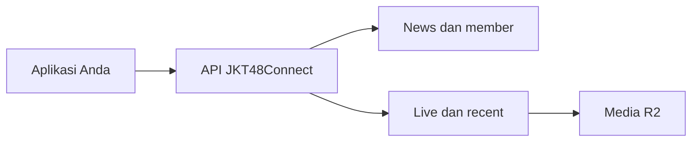

# Markdown, tanpa kehilangan detail

Halaman ini memakai renderer yang sama dengan seluruh panduan. CommonMark dan
GitHub Flavored Markdown didukung, bersama matematika serta Mermaid.

## Teks & tautan

**Tebal**, *miring*, ~~dicoret~~, `inline code`, dan [katalog route](/docs/reference).
Anda juga dapat memakai tautan otomatis: https://api.jkt48connect.app/docs.

> [!NOTE]
> Contoh autentikasi memakai placeholder. Gunakan API key server hanya dari backend.

## Tabel & task list

| Format | Respons | Kegunaan |
| :--- | :--- | :--- |
| JSON | `application/json` | Data API |
| PNG | `image/png` | Leaderboard |
| HLS | `application/vnd.apple.mpegurl` | Replay |

- [x] Heading dan anchor
- [x] Tabel, daftar, kutipan, dan tautan
- [x] Footnote, diagram, dan matematika
- [ ] Integrasi aplikasi Anda

## Kode dengan syntax highlight

```javascript
const response = await fetch('/api/news?page=1&perpage=10');
if (!response.ok) throw new Error(`HTTP ${response.status}`);
const { news } = await response.json();
console.log(news);
```

## Diagram aliran



## Matematika

Gold yang belum mempunyai rincian event dihitung per pengguna:

$$
G_{belum\ terurai} = \sum_u \max(0, G_{sumber,u} - G_{event,u})
$$

Nilai $G_{sumber}$ adalah snapshot top-gifter IDN, bukan jumlah jenis gift.

## HTML & catatan kaki

<details><summary>Catatan tentang HTML</summary>

HTML presentasional yang aman, seperti **details**, summary, subscript, dan
superscript, dapat dipakai. Elemen aktif dan atribut event disaring.

</details>

Sumber gold dan rincian gift memiliki cakupan berbeda.[^data]

[^data]: Lihat panduan [gift dan leaderboard](/docs/guide/gift-dan-leaderboard).

---

Data tetap terbaca di layar kecil, termasuk tabel dan kode yang dapat digeser.
