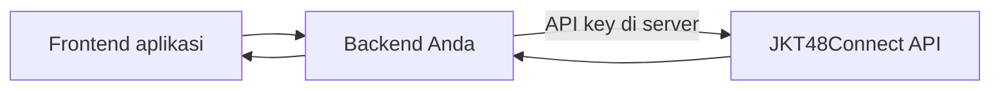

# Akses & integrasi

Label akses di API Reference menjelaskan kebutuhan setiap endpoint. Endpoint **Publik** dapat dipanggil tanpa credential. Beberapa data, termasuk daftar serta detail recent, memerlukan akses integrasi.

## API key untuk aplikasi

Minta akses API key kepada pengelola JKT48Connect. Gunakan key dari **backend** aplikasi dan simpan sebagai environment variable, bukan di JavaScript browser atau repository publik.

```sh
curl 'https://api.jkt48connect.app/api/recent?page=1&perpage=10' \
  -H "x-api-key: ${JKT48_API_KEY}"
```

```js
// Contoh pada backend Node.js.
const response = await fetch(
  'https://api.jkt48connect.app/api/recent?page=1&perpage=10',
  { headers: { 'x-api-key': process.env.JKT48_API_KEY } },
);
if (!response.ok) throw new Error(`HTTP ${response.status}`);
const data = await response.json();
```

> [!IMPORTANT]
> `SERVER_API_KEY` pada contoh referensi adalah placeholder. Halaman docs tidak menyimpan atau meminta key Anda. Playground hanya mencoba GET publik yang diizinkan.

## Frontend dan backend

Frontend dapat mengambil endpoint publik secara langsung. Untuk endpoint berkey, frontend memanggil backend Anda; backend menambahkan key sebelum meneruskan request.



## Ketika akses ditolak

Periksa status HTTP, label akses, dan bentuk header. Hindari mengirim key melalui parameter URL kecuali kontrak endpoint secara eksplisit memerlukannya. Jika key belum tersedia, mulai dari news, member, jadwal, atau media publik.
