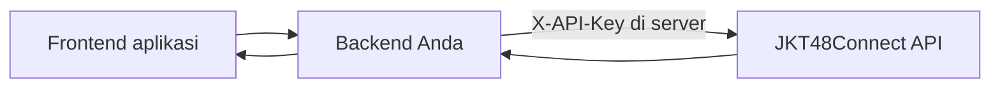

# Akses & integrasi

Setiap request ke endpoint data `/api` memakai **API key** milikmu. Key gratis, langsung aktif, dan setiap key punya kuota bulanan sendiri.

## Buat API key

1. [Daftar akun](/register) atau [masuk](/login) ke dashboard developer.
2. Buka [API Keys](/dashboard/keys), beri nama, lalu klik **Buat API key**.
3. Salin key `jkc_…` yang tampil. Key lengkap hanya ditampilkan sekali.

### Format key

Key developer selalu berbentuk `jkc_` diikuti 40 karakter heksadesimal huruf kecil, total 44 karakter:

```text
jkc_8f3a1c0b7e2d4a9f6c5b1e0d3a7f9c2b4e6d9d2e
^^^^ prefix tetap
    ^^^^^^^^^^^^^^^^^^^^^^^^^^^^^^^^^^^^^^^^ 40 karakter hex (0-9, a-f), acak per key
```

Dashboard hanya menampilkan bentuk ringkas seperti `jkc_8f3a1c…9d2e` (prefix + 4 karakter terakhir). Server menyimpan hash SHA-256, bukan key aslinya, jadi key yang hilang tidak bisa dilihat ulang: buat key baru lalu cabut yang lama. Validasi format di aplikasimu sebelum mengirim request:

```js
const KEY_FORMAT = /^jkc_[a-f0-9]{40}$/;
if (!KEY_FORMAT.test(process.env.JKT48CONNECT_API_KEY ?? '')) {
  throw new Error('JKT48CONNECT_API_KEY tidak valid: harus jkc_ + 40 karakter hex');
}
```

### Tiga cara mengirim key

| Cara | Contoh | Kapan dipakai |
| --- | --- | --- |
| Header `X-API-Key` | `-H "X-API-Key: jkc_…"` | **Disarankan.** Backend, bot, server-to-server |
| Query `apikey` | `?apikey=jkc_…` | Klien yang tidak bisa menambah header (webhook, spreadsheet, embed sederhana) |
| Query `api_key` | `?api_key=jkc_…` | Sama seperti `apikey`, untuk library yang memakai snake_case |

Jika header dan query dikirim bersamaan, header yang dipakai.

Simpan key sebagai environment variable di **server** aplikasi. Jangan menaruh key di JavaScript browser atau repository publik.

```sh
curl 'https://api.jkt48connect.app/api/news?page=1&perpage=10' \
  -H "X-API-Key: ${JKT48CONNECT_API_KEY}"
```

```js
// Backend Node.js
const response = await fetch(
  'https://api.jkt48connect.app/api/news?page=1&perpage=10',
  { headers: { 'X-API-Key': process.env.JKT48CONNECT_API_KEY } },
);
if (!response.ok) throw new Error(`HTTP ${response.status}`);
const data = await response.json();
```

### Contoh key lewat query

Bila klien tidak bisa menambah header (webhook, bot sederhana, spreadsheet), kirim key sebagai parameter `apikey` atau `api_key`:

```sh
curl "https://api.jkt48connect.app/api/news?page=1&apikey=${JKT48CONNECT_API_KEY}"
```

Header `X-API-Key` tetap didahulukan bila keduanya dikirim. Parameter key dihapus sebelum request diproses, jadi tidak ikut tersimpan di cache maupun diteruskan ke sumber data.

> [!WARNING]
> URL mudah bocor lewat riwayat browser, log proxy, dan header `Referer`. Pakai query hanya untuk klien server-ke-server, dan [buat key baru](/dashboard/keys) bila URL ber-key pernah dibagikan.

## Membaca error

Respons `401` dan `429` selalu JSON dengan bentuk yang sama, sehingga mudah ditangani di satu tempat:

```json
{
  "status": 429,
  "message": "Kuota bulanan API key ini habis. Isi ulang di dashboard atau tunggu reset awal bulan.",
  "limit": 25000,
  "used": 25000,
  "resets_at": "2026-10-31T17:00:00.000Z",
  "dashboard": "https://api.jkt48connect.app/dashboard/keys",
  "docs": "https://api.jkt48connect.app/docs/guide/autentikasi-dan-integrasi",
  "path": "/api/news"
}
```

Lihat [Contoh integrasi](/docs/guide/contoh-integrasi) untuk client lengkap dengan retry, cache, dan pembacaan kuota.

## Detail setiap request

[Log request](/dashboard/logs) di dashboard menyimpan detail tiap panggilan selama 7 hari: IP, negara, kota, jaringan/ISP, user agent, origin, cara key dikirim (header atau query), query, header, dan nama cookie. Nilai rahasia seperti key, `Authorization`, dan isi cookie disamarkan sebelum disimpan.

> [!IMPORTANT]
> `JKT48CONNECT_API_KEY` pada contoh referensi adalah placeholder. Tombol **Coba GET** di referensi memakai key yang kamu isi sendiri dan menyimpannya hanya di browser-mu.

## Paket dan kuota bulanan

Kuota dihitung per key dan direset setiap tanggal 1 pukul 00.00 WIB.

| Paket | Kuota per bulan | Cara mendapatkan |
| --- | --- | --- |
| Free | 1.000 request | Otomatis untuk key baru |
| Fanbase | 50.000 request | Gratis untuk fanbase terverifikasi lewat [program fanbase](/dashboard/fanbase) |
| Starter | 25.000 request | Dibeli per 30 hari di [Paket & tagihan](/dashboard/billing) |
| Pro | 150.000 request | Dibeli per 30 hari di [Paket & tagihan](/dashboard/billing) |

Kuota yang habis di tengah bulan bisa **diisi ulang** (+5.000 sampai +100.000 request) dengan QRIS atau voucher. Isi ulang berlaku sampai akhir bulan berjalan.

## Membaca sisa kuota

Setiap respons ber-key membawa header kuota:

| Header | Arti |
| --- | --- |
| `X-RateLimit-Limit` | Kuota bulan ini, termasuk isi ulang |
| `X-RateLimit-Remaining` | Sisa request bulan ini |
| `X-RateLimit-Reset` | Waktu reset (Unix detik) |
| `X-Quota-Period` | Periode kuota, misalnya `2026-10` |

## Frontend dan backend

Frontend memanggil backend-mu; backend menambahkan key sebelum meneruskan request. Dengan begitu key tidak pernah sampai ke browser pengguna.



## Ketika akses ditolak

| Status | Arti | Yang perlu dilakukan |
| --- | --- | --- |
| `401` | Key tidak ada, salah, atau sudah dicabut | Kirim header `X-API-Key` (atau `?apikey=`) dengan key aktif dari dashboard |
| `429` | Kuota bulanan key habis | Isi ulang atau upgrade paket, atau tunggu reset; lihat `Retry-After` |

Pantau pemakaian, error, dan log setiap request di [dashboard](/dashboard).
