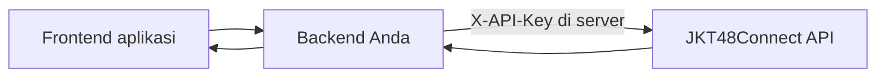

# Akses & integrasi

Setiap request ke endpoint data `/api` memakai **API key** milikmu. Key gratis, langsung aktif, dan setiap key punya kuota bulanan sendiri.

## Buat API key

1. [Daftar akun](/register) atau [masuk](/login) ke dashboard developer.
2. Buka [API Keys](/dashboard/keys), beri nama, lalu klik **Buat API key**.
3. Salin key `jkc_…` yang tampil. Key lengkap hanya ditampilkan sekali.

Simpan key sebagai environment variable di **server** aplikasi. Jangan menaruh key di JavaScript browser atau repository publik.

```sh
curl 'https://api.jkt48connect.app/api/news?page=1&perpage=10' \
  -H "X-API-Key: ${JKT48CONNECT_API_KEY}"
```

```js
// Backend Node.js
const response = await fetch(
  'https://api.jkt48connect.app/api/news?page=1&perpage=10',
  { headers: { 'X-API-Key': process.env.JKT48CONNECT_API_KEY } },
);
if (!response.ok) throw new Error(`HTTP ${response.status}`);
const data = await response.json();
```

> [!IMPORTANT]
> `JKT48CONNECT_API_KEY` pada contoh referensi adalah placeholder. Tombol **Coba GET** di referensi memakai key yang kamu isi sendiri dan menyimpannya hanya di browser-mu.

## Paket dan kuota bulanan

Kuota dihitung per key dan direset setiap tanggal 1 pukul 00.00 WIB.

| Paket | Kuota per bulan | Cara mendapatkan |
| --- | --- | --- |
| Free | 1.000 request | Otomatis untuk key baru |
| Fanbase | 50.000 request | Gratis untuk fanbase terverifikasi lewat [program fanbase](/dashboard/fanbase) |
| Starter | 25.000 request | Dibeli per 30 hari di [Paket & tagihan](/dashboard/billing) |
| Pro | 150.000 request | Dibeli per 30 hari di [Paket & tagihan](/dashboard/billing) |

Kuota yang habis di tengah bulan bisa **diisi ulang** (+5.000 sampai +100.000 request) dengan QRIS atau voucher. Isi ulang berlaku sampai akhir bulan berjalan.

## Membaca sisa kuota

Setiap respons ber-key membawa header kuota:

| Header | Arti |
| --- | --- |
| `X-RateLimit-Limit` | Kuota bulan ini, termasuk isi ulang |
| `X-RateLimit-Remaining` | Sisa request bulan ini |
| `X-RateLimit-Reset` | Waktu reset (Unix detik) |
| `X-Quota-Period` | Periode kuota, misalnya `2026-10` |

## Frontend dan backend

Frontend memanggil backend-mu; backend menambahkan key sebelum meneruskan request. Dengan begitu key tidak pernah sampai ke browser pengguna.



## Ketika akses ditolak

| Status | Arti | Yang perlu dilakukan |
| --- | --- | --- |
| `401` | Key tidak ada, salah, atau sudah dicabut | Kirim header `X-API-Key` dengan key aktif dari dashboard |
| `429` | Kuota bulanan key habis | Isi ulang atau upgrade paket, atau tunggu reset; lihat `Retry-After` |

Pantau pemakaian, error, dan log setiap request di [dashboard](/dashboard).
